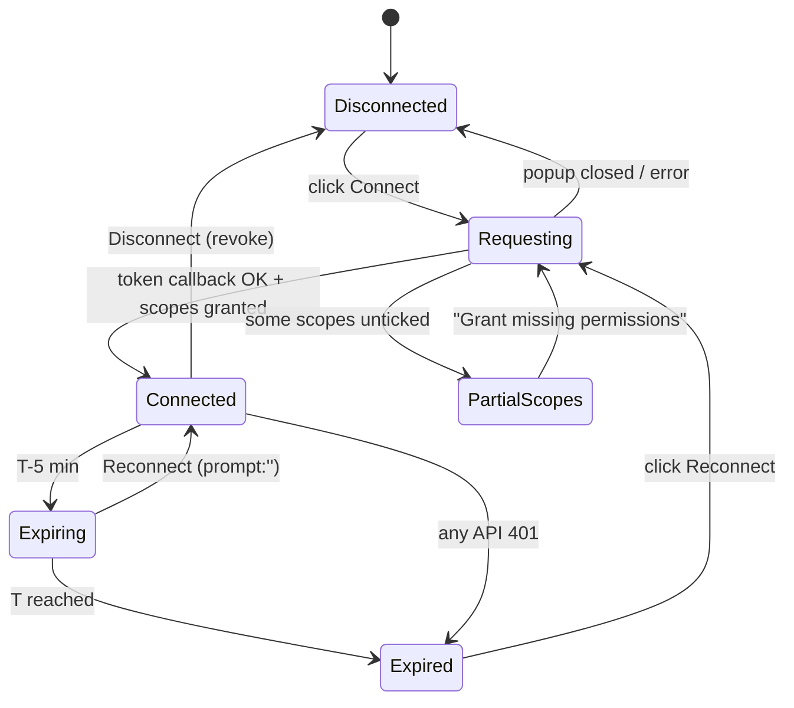

# API Integration Plan

Status: Draft for review · Version 0.2 (adds service worker and installed-app notes, §4.1 and §10)

This document lists **only documented Google capabilities**. Where something can't be done reliably from a browser-only app, it says so explicitly (see §9).

---

## 1. Google Cloud configuration (one-time, manual)

1. **Create a project** at https://console.cloud.google.com, for example `job-apply-automation`.
2. **Enable APIs** (APIs & Services → Library):
   - Google Sheets API
   - Gmail API
   - The Google Picker API and Google Drive API are needed only if the Picker + `drive.file` option is chosen later.
3. **OAuth consent screen** (Google Auth Platform → Branding / Audience / Data Access):
   - User type: **External** for a personal @gmail.com account, or **Internal** if you're on Google Workspace and the app is only for your org.
   - Publishing status: keep it in **Testing**, and add your own Gmail address under **Test users**. Testing apps are limited to 100 test users and show a "Google hasn't verified this app" warning. Both are fine for personal use.
   - Add the scopes listed in §2.
4. **Create OAuth client** (Clients → Create client → **Web application**):
   - Authorized JavaScript origins: `http://localhost:5173` and your production origin (for example `https://jobapply.vercel.app`).
   - Authorized redirect URIs are **not needed** for the GIS token (popup) model.
   - Copy the **Client ID** into `.env.local` as `VITE_GOOGLE_CLIENT_ID`. There is no client secret in this app, and none is needed.
5. **API key**: not required. Every call uses an OAuth bearer token.

> Publishing to "In production" for other users would require Google OAuth verification. With restricted Gmail scopes (§2), it would also require an annual third-party security assessment. That's out of scope for a personal tool.

## 2. OAuth scopes

| Scope | Classification | Requested when | Purpose |
|---|---|---|---|
| `openid` | Non-sensitive | Connect | Identity |
| `email` | Non-sensitive | Connect | Show the connected Gmail address |
| `profile` | Non-sensitive | Connect | Name and avatar in the UI |
| `https://www.googleapis.com/auth/spreadsheets` | Sensitive | Connect | Read and write any sheet the user can access (needed for pasted URLs) |
| `https://www.googleapis.com/auth/gmail.send` | Sensitive | Connect | Send email only. It cannot read the mailbox. |
| `https://www.googleapis.com/auth/gmail.metadata` | **Restricted** | When reply tracking is turned on (incremental) | Read message headers and labels in threads. No bodies. |

Alternatives considered:
- **`drive.file` instead of `spreadsheets`**: a non-sensitive, narrower scope, but it only grants access to files the user opens through the **Google Picker** or files the app created. Pasting a URL alone wouldn't work. This is listed as a future option.
- **`gmail.readonly` instead of `gmail.metadata`**: also restricted, but it allows `messages.list` with a `q` search query, which would enable "search for replies outside the thread". It also exposes full message bodies to the app. That's not needed for MVP, so it's rejected for least privilege.
- **`gmail.modify` / `https://mail.google.com/`**: broader than required. Rejected.

## 3. Google Identity Services (GIS) usage

Script: `<script src="https://accounts.google.com/gsi/client" async defer></script>` (loaded by `services/googleAuth.js` on demand).

```js
const tokenClient = google.accounts.oauth2.initTokenClient({
  client_id: import.meta.env.VITE_GOOGLE_CLIENT_ID,
  scope: BASE_SCOPES.join(' '),
  include_granted_scopes: true,
  callback: handleTokenResponse,         // { access_token, expires_in, scope, error? }
  error_callback: handlePopupError,      // popup_closed, popup_failed_to_open
});
tokenClient.requestAccessToken({ prompt: 'consent', login_hint });   // first time
tokenClient.requestAccessToken({ prompt: '' , login_hint });          // reconnect
google.accounts.oauth2.hasGrantedAllScopes(tokenResponse, SCOPE_GMAIL_SEND);
google.accounts.oauth2.revoke(accessToken, () => {});
```

Identity: `GET https://openidconnect.googleapis.com/v1/userinfo` with the bearer token returns `{ sub, email, email_verified, name, picture }`.

## 4. Token lifecycle



- Lifetime: `expires_in` is typically 3599 seconds. Always use the returned value, never hard-code it.
- No refresh token exists in the token model, so renewal always needs `requestAccessToken`, which must be triggered by a user gesture.
- The token is kept in memory and lost on reload, by design. Reconnect with `login_hint` is usually a single click.

### 4.1 Installed app (PWA) notes

- The installed app uses the same origin as the website, so the same Authorized JavaScript origin applies. No extra OAuth client is needed.
- The GIS popup opens as a browser window from the installed app. This is expected to work on Chrome and Edge (desktop and Android). It must be verified in Phase 5 (AC-22).
- On iOS, home-screen apps have separate storage from Safari, and popups from standalone mode are unreliable. If sign-in fails there, the app recommends using Safari on iPhone, and the iOS install instructions are hidden (risk R20).
- Going offline doesn't revoke the token, but it may expire while offline. After reconnecting, the first request may return 401 and lead to the normal Reconnect flow.

## 5. Google Sheets API v4

Base URL: `https://sheets.googleapis.com/v4/spreadsheets`

| Use | Method & path | Key params / body |
|---|---|---|
| Validate access + list tabs | `GET /{spreadsheetId}` | `fields=spreadsheetId,properties.title,sheets.properties(sheetId,title,index,gridProperties(rowCount,columnCount))` |
| Read header row | `GET /{spreadsheetId}/values/{range}` | `range='Applications'!1:1` (URL-encoded; quote tab names containing spaces) |
| Read all records | `GET /{spreadsheetId}/values/{range}` | `range='Applications'`, `valueRenderOption=FORMATTED_VALUE`, `majorDimension=ROWS` |
| Read ID column only | `GET /{spreadsheetId}/values/{range}` | `range='Applications'!A:A` (letter resolved from mapping) |
| Read several ranges at once (setup header rows; Sync reads the tab and Email_Log together) | `GET /{spreadsheetId}/values:batchGet` | repeated `ranges=`, `majorDimension=ROWS`, `valueRenderOption=FORMATTED_VALUE` |
| Widen a tab before adding tracking headers | `POST /{spreadsheetId}:batchUpdate` | `{ requests: [{ appendDimension: { sheetId, dimension: "COLUMNS", length } }] }` |
| Batch write cells | `POST /{spreadsheetId}/values:batchUpdate` | `{ valueInputOption: "RAW", data: [{ range, values }] }` |
| Append header cells | `PUT /{spreadsheetId}/values/{range}` | `valueInputOption=RAW` |
| Append log row | `POST /{spreadsheetId}/values/{range}:append` | `range='Email_Log'!A1`, `valueInputOption=RAW`, `insertDataOption=INSERT_ROWS` |
| Create Email_Log tab | `POST /{spreadsheetId}:batchUpdate` | `{ requests: [{ addSheet: { properties: { title: "Email_Log" } } }] }` |

Notes:
- `values.get` omits trailing empty cells and rows. The parser pads each row to the header length.
- Spreadsheet ID extraction: `/\/spreadsheets\/d\/([a-zA-Z0-9-_]+)/`. The `#gid=` hash identifies a tab's numeric `sheetId`, which is used to preselect the worksheet.

**Quotas** (per Google's Sheets API usage limits page; verify at build time):
- Read requests: 300 per minute per project, and **60 per minute per user per project**.
- Write requests: 300 per minute per project, and **60 per minute per user per project**.
- No daily limit. A 429 means the per-minute bucket is exhausted, so back off.
- Design impact: one read per sync, and one batched write per sent email (status cells) plus one append (log). A 50-email campaign uses about 100 write requests spread over about 17 minutes (with a 20 s delay), well under the limit.

## 6. Gmail API v1

Base URL: `https://gmail.googleapis.com`

### 6.1 Send

| Use | Method & path |
|---|---|
| Send with attachment | `POST /upload/gmail/v1/users/me/messages/send?uploadType=media` with header `Content-Type: message/rfc822` and the raw RFC 2822 message as the body |
| Alternative (small, no attachment) | `POST /gmail/v1/users/me/messages/send` with `{ "raw": "<base64url RFC 2822>" }` |

Response: `{ "id": "...", "threadId": "...", "labelIds": ["SENT"] }`. `id` is stored as **Gmail Message ID** and `threadId` as **Thread ID**.

MIME structure built by `lib/mime.js`:

```
From: "Jane Doe" <jane@gmail.com>
To: priya@acme.com
Subject: =?UTF-8?B?<base64 subject>?=
MIME-Version: 1.0
Content-Type: multipart/mixed; boundary="b1_<random>"

--b1_<random>
Content-Type: text/plain; charset="UTF-8"
Content-Transfer-Encoding: base64

<base64 body, 76-char lines>
--b1_<random>
Content-Type: application/pdf; name="Resume_Jane_Doe.pdf"
Content-Disposition: attachment; filename="Resume_Jane_Doe.pdf"
Content-Transfer-Encoding: base64

<base64 pdf, 76-char lines>
--b1_<random>--
```

Limits: the Gmail API `/upload` endpoint for messages accepts up to **35 MB**. Gmail's normal attachment limit is **25 MB**. The app enforces **5 MB** for resumes, which is a deliverability best practice, and recipients' servers may reject large mail.

Gmail only accepts a `From` address that is the account itself or a configured "Send mail as" alias. Otherwise Gmail rewrites it to the account's primary address.

### 6.2 Reply tracking (thread-based)

| Use | Method & path |
|---|---|
| Read a thread's headers | `GET /gmail/v1/users/me/threads/{threadId}?format=metadata&metadataHeaders=From&metadataHeaders=Subject&metadataHeaders=Date&metadataHeaders=Auto-Submitted&metadataHeaders=X-Autoreply&metadataHeaders=Precedence` |

What `gmail.metadata` **allows**: `threads.get` / `messages.get` with `format=metadata` or `minimal`, plus `labelIds`, `internalDate`, and headers.
What it **does not allow**: message bodies (`format=full`/`raw`) and the `q` search parameter on `messages.list` / `threads.list`.

Classification (`lib/replyClassifier.js`). For every message in the thread after the original sent message:

1. If `labelIds` contains `SENT`, the message is the user's own (follow-up or test) and is ignored.
2. If `From` matches `mailer-daemon@` or `postmaster@`, or the subject starts with "Delivery Status Notification" / "Undeliverable" / "Mail delivery failed", the result is **Bounced**.
3. If `Auto-Submitted` is present and not `no`, or `X-Autoreply` is present, or `Precedence` is `auto_reply`, or the subject starts with "Automatic reply" / "Out of Office" / "Auto:", the result is **Auto-Reply**. Keep scanning, because a later human reply upgrades this to Replied.
4. If the sender address equals the recipient, or the sender's domain equals the recipient's domain, the result is **Replied**, with Reply Date = that message's `internalDate`.
5. Any other sender (for example an ATS `no-reply@greenhouse.io`, or a different company domain) is **Uncertain**, shown as "Possible reply from X — verify in Gmail".
6. If there are no other messages, the result is **No Reply**.
7. A 404 on the thread (the user deleted it) is **Uncertain** ("Thread not found").

Precedence: Replied > Bounced > Uncertain > Auto-Reply > No Reply.

The UI links each row to `https://mail.google.com/mail/u/0/#all/{threadId}`, so the user can verify any status manually.

### 6.3 Gmail quotas and sending limits

API quota (per Gmail API usage limits page; verify at build time):
- Per-user rate limit: **15,000 quota units per minute**.
- `messages.send`: 100 units. `threads.get`: 10 units. `messages.get`: 5 units.
- Design impact: negligible at 1 send per 20 s. A reply check of 200 threads is about 2,000 units, so it's throttled at around 5 requests per second.

**Account sending limits** (separate from API quota, and enforced by Gmail itself):
- Consumer @gmail.com: about **500 recipients per day** (Google's published guideline). New or low-reputation accounts may be throttled lower without notice.
- Google Workspace: about **2,000 messages per day** (lower during trial periods).
- Exceeding these can temporarily suspend sending for up to 24 hours.
- The app defaults to a **50/day cap** and a **20 s delay**, both configurable, with a hard upper cap of 400/day in the UI.

## 7. Error handling matrix

| Source | Status / reason | Retry? | User message |
|---|---|---|---|
| GIS | `popup_closed` | No | "Sign-in was cancelled." |
| GIS | `popup_failed_to_open` | No | "Your browser blocked the Google popup. Allow popups for this site." |
| GIS | `access_denied` | No | "Permission was not granted." |
| Any | 401 | After reconnect | "Your Google session expired. Reconnect to continue." |
| Any | 403 insufficient scope | After consent | "This feature needs an extra permission." with a Grant button |
| Sheets | 403 `PERMISSION_DENIED` | No | "You don't have edit access to this spreadsheet." |
| Sheets | 404 | No | "Spreadsheet not found. Check the URL." |
| Sheets | 400 `Unable to parse range` | No | "Worksheet '{tab}' no longer exists. Re-select a worksheet." |
| Any | 429, 403 `rateLimitExceeded`/`userRateLimitExceeded` | Yes, backoff 2/4/8 s with jitter | "Google is rate-limiting requests. Retrying…" |
| Gmail | Daily sending limit error | No (stop campaign) | "Gmail's daily sending limit was reached. Remaining emails were not sent." |
| Gmail | 400 `Invalid To header` | No | "Recipient address was rejected." |
| Any | 5xx | Yes, backoff | "Google service error. Retrying…" |
| Network | `TypeError: Failed to fetch` | Yes, on `online` | "You appear to be offline." |

## 8. Request budget per user action

| Action | API calls |
|---|---|
| Connect | 1 userinfo |
| Configure sheet | 1 `spreadsheets.get` + 1 header read (+ 1 header write if columns are added) |
| Sync Now | 1 `values.get` (+ 1 `batchUpdate` if IDs were assigned, + flush of pending write-backs) |
| Start campaign | 1 ID+status column read (fresh duplicate check) (+ 1 `addSheet` the first time) |
| Each email | 1 `messages.send` + 1 `values:batchUpdate` + 1 `values:append` |
| Test email | 1 `messages.send` + 1 `values:append` |
| Check replies (N threads) | N `threads.get` + 1 `values:batchUpdate` |

## 9. What can't be done reliably in a frontend-only app

| Capability | Why not | Practical approach |
|---|---|---|
| Sending while the tab is closed, or scheduled sends | There's no process running without a server. Browser background timers get throttled. | Sending runs only while the tab is open. A wake-lock hint plus "keep this tab open" UI. The queue persists and resumes after reload. |
| Long-lived sessions (refresh tokens) | The token model issues none. The code model needs a client secret on a server. | One-click reconnect with `login_hint`. Pre-flight token check before campaigns. |
| Automatic or real-time reply detection | Gmail push notifications (`users.watch`) require a Cloud Pub/Sub subscriber endpoint, which is a backend. | Manual "Check replies" button, plus an optional check when the app opens. |
| Detecting replies sent as a new email (not in the thread) | Needs a mailbox search (`q`), which needs `gmail.readonly`, and matching is heuristic. | MVP: thread-based only, with the UI saying so. Future: opt-in search, labeled "Possible reply". |
| Open or click tracking | Needs a server for pixels or redirects. It's also unreliable because of image proxies. | Not implemented. |
| Guaranteed exactly-once sending | A crash between Gmail success and the queue save is possible. | Persist `sending` before the call and `sent` immediately after. On resume, items stuck in `sending` are marked "Unknown — check Sent folder" and **not** auto-resent. |
| Storing the resume across devices | No storage server. LocalStorage is about 5 MB and string-only. | MVP: persisted per browser in IndexedDB. Other devices need their own upload. Future: Drive file via Picker + `drive.file`. |
| Hiding the OAuth Client ID | It's public by design in SPAs. | Restrict Authorized JavaScript origins. The Client ID alone grants nothing. |
| Distributing to other users | Restricted scopes need verification and a security assessment. | Personal use in Testing mode only. |
| Background Sync / Periodic Sync / push | These would need the service worker to hold tokens (forbidden) or a push server (no backend). | Not implemented. Pending work waits for the user after reconnecting. |
| Native Android APK | A PWA is not an APK. Packaging (TWA or Capacitor) is a separate build with signing and its own OAuth client type. | Future feature (PRD §4.2). |

## 10. Service worker and Google APIs

- The service worker **never intercepts** Google requests. They are cross-origin, outside the precache, and `runtimeCaching` is empty.
- `services/http.js` sends every request with `cache: 'no-store'`, so neither the HTTP cache nor the service worker stores Google responses.
- The GIS script (`accounts.google.com/gsi/client`) is loaded from the network on demand and is not precached. Offline, the Connect button is disabled with "Needs a connection".
- Requests are never queued in the service worker. Pending operations live in the page (LocalStorage queue and write-back list) and need a user click to run.
