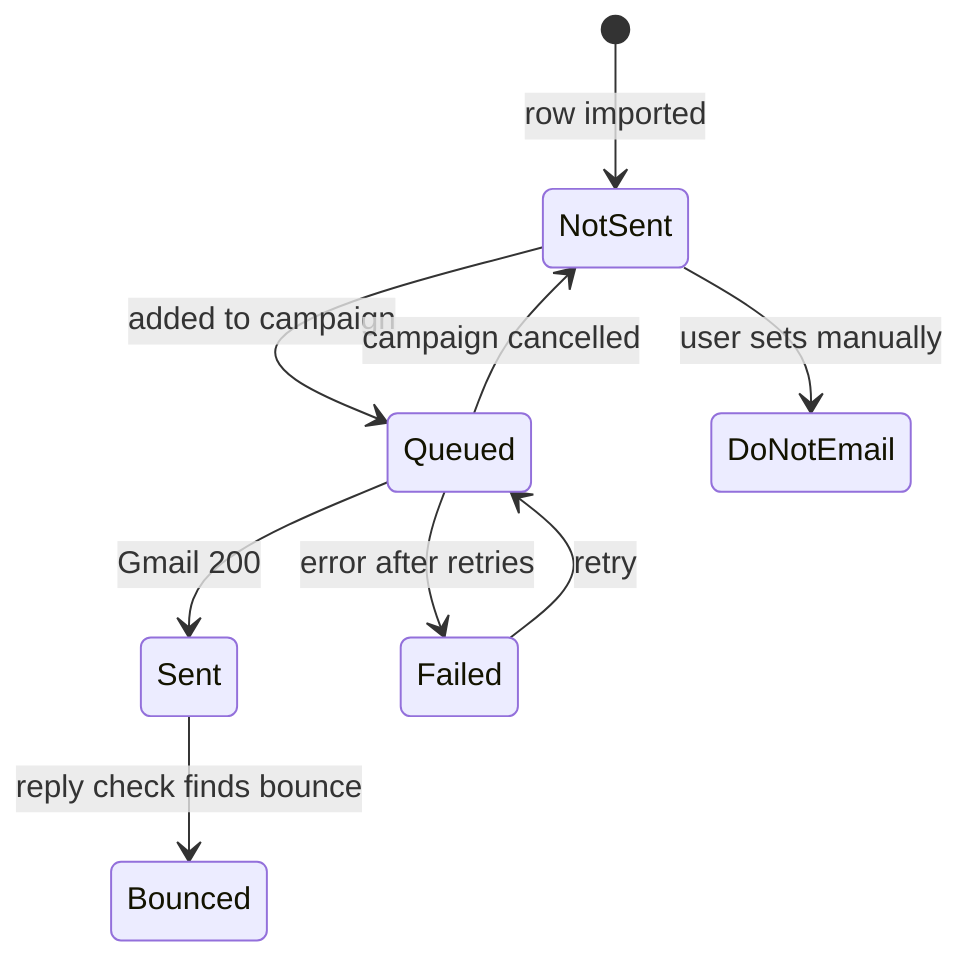
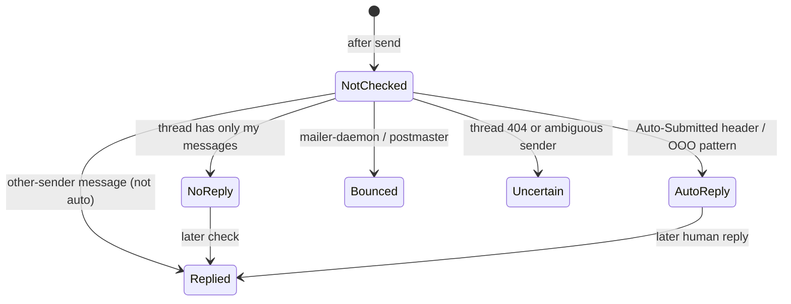

# Data Model — Google Sheets Schema & Local Storage

Status: Draft for review · Version 0.2 (adds the snapshot, log snapshot, notifications, and UI preference objects)

There is no database. The "schema" has three parts:

1. The **Applications** worksheet (user-owned, primary data).
2. The **Email_Log** worksheet (app-created, append-only history).
3. LocalStorage objects (config and preferences only).

---

## 1. Applications worksheet

Row 1 holds the headers, and each later row is one application. Header names are matched case-insensitively, ignoring spaces and underscores, so `Recruiter Email`, `recruiter_email`, and `RecruiterEmail` all map automatically. The user can override any mapping.

### 1.1 Columns

| # | Header (default) | App field | Owner | Required | Type / allowed values | Notes |
|---|---|---|---|---|---|---|
| A | Application ID | `id` | App | System | UUID v4 string | Generated on first sync if empty. **Never edit by hand.** |
| B | Company Name | `companyName` | User | **Yes** | text | |
| C | Recruiter Name | `recruiterName` | User | No | text | `recruiter_first_name` = first token |
| D | Recruiter Email | `recruiterEmail` | User | **Yes** | email | Validated on sync |
| E | Job Title | `jobTitle` | User | **Yes** | text | |
| F | Job Link | `jobLink` | User | No | URL | Used in dedupe if present |
| G | Template Name | `templateName` | App/User | No | text | Pre-fill to choose a template per row; the app writes the template actually used |
| H | Application Status | `applicationStatus` | User (app advances once) | No | `Not Applied` · `Applied` · `Interviewing` · `Offer` · `Rejected` · `Withdrawn` · `On Hold` | Empty is treated as `Not Applied` |
| I | Email Status | `emailStatus` | App | System | `Not Sent` · `Queued` · `Sent` · `Failed` · `Bounced` · `Do Not Email` | User may set `Do Not Email` manually |
| J | Sent Date | `sentDate` | App | System | ISO 8601 (`2026-11-04T10:15:00+05:30`) | Time of the last successful send |
| K | Gmail Message ID | `gmailMessageId` | App | System | string (Gmail internal ID, e.g. `18c2f...`) | Not the RFC `Message-ID` header |
| L | Thread ID | `threadId` | App | System | string | Required for reply tracking |
| M | Reply Status | `replyStatus` | App | System | `Not Checked` · `No Reply` · `Replied` · `Auto-Reply` · `Bounced` · `Uncertain` | |
| N | Reply Date | `replyDate` | App | System | ISO 8601 | Date of the first detected reply |
| O | Last Error | `lastError` | App | System | text (≤ 500 chars) | Cleared on the next successful send |
| P | Notes | `notes` | User | No | text | Never written by the app |

Column order doesn't matter, because the mapping is by header. The order above is what the app suggests when it creates missing system columns, which it appends to the right of existing columns after confirmation.

### 1.2 Example

| Application ID | Company Name | Recruiter Name | Recruiter Email | Job Title | Job Link | Template Name | Application Status | Email Status | Sent Date | Gmail Message ID | Thread ID | Reply Status | Reply Date | Last Error | Notes |
|---|---|---|---|---|---|---|---|---|---|---|---|---|---|---|---|
| 3f2a…c91 | Acme Corp | Priya Sharma | priya@acme.com | Frontend Engineer | https://acme.com/jobs/42 | Cold Outreach | Applied | Sent | 2026-11-04T10:15:00+05:30 | 18c2f4a9b1e0d7aa | 18c2f4a9b1e0d7aa | Replied | 2026-11-05T09:02:00+05:30 | | Referred by Raj |
| | Globex | | hr@globex | Data Analyst | | | | | | | | | | | |

The second row would be flagged **Invalid** on sync, because `hr@globex` has no top-level domain.

## 2. Unique identification

**Application ID (UUID v4)** is the stable primary key.

- It's generated client-side with `crypto.randomUUID()` during Sync for any row whose ID cell is empty.
- It's written back to the sheet in a single `values:batchUpdate`.
- All later write-backs locate rows by searching the ID column. The app never uses a cached row number, because users sort, filter, insert, and delete rows freely.
- If a user copies a row (duplicating its ID), sync detects the **duplicate ID**. It keeps the first one, flags the second as "Duplicate ID — clear the ID cell to re-assign", and skips it.

## 3. Duplicate detection

Duplicates are checked at two levels.

### 3.1 Record duplicates (at Sync)

Dedupe key:

```
key = normalize(recruiterEmail) + "|" + normalize(companyName) + "|" + (normalizeUrl(jobLink) || normalize(jobTitle))
```

- `normalize`: trim, lower-case, collapse whitespace, strip trailing punctuation.
- `normalizeUrl`: lower-case host, drop the protocol, `www.`, trailing slash, query-string tracking params (`utm_*`, `ref`, `trk`), and the hash.
- The first row with a given key is imported, and later rows are counted as **Skipped (duplicate)** with a link to the original row number.
- Rationale: the same recruiter can legitimately be contacted about two different roles. The same recruiter and the same role is a duplicate.

### 3.2 Send duplicates (at Campaign time)

This is the more important check, because it stops a recruiter from getting the same email twice.

1. **Status gate**: rows with Email Status `Sent`, `Queued`, or `Do Not Email` are excluded by default.
2. **Recipient gate**: within one campaign, the same recruiter email appears only once, even if it's linked to two roles. The user is warned and must pick which application to use.
3. **Recency gate**: if the same recruiter email received **any** email from the app in the last 14 days (checked in Email_Log), the app shows a warning and the recipient is unticked by default.
4. **Fresh re-read**: immediately before starting, the app re-reads Email Status for the selected IDs from the sheet, which catches sends from another tab or device.
5. **Queue idempotency**: the local queue stores per-ID state. After a reload, IDs already marked `sent` in the queue are never re-sent, even if the sheet write-back failed (they go to `pendingWritebacks`).
6. **Override**: Settings has "Allow re-sending to already-emailed rows". It's off by default, and when on, each campaign needs an extra confirmation.

## 4. Email_Log worksheet (app-created)

Append-only. It's created automatically, with confirmation, on the first send. One row per send attempt, including test sends and failures.

| Column | Type | Example |
|---|---|---|
| Log ID | UUID | `a81e…` |
| Timestamp | ISO 8601 | `2026-11-04T10:15:00+05:30` |
| Campaign ID | UUID | groups the sends of one campaign |
| Application ID | UUID / empty for test | `3f2a…c91` |
| Recipient Email | email | `priya@acme.com` |
| Company Name | text | `Acme Corp` |
| Job Title | text | `Frontend Engineer` |
| Template Name | text | `Cold Outreach` |
| Subject | text | `Frontend Engineer role at Acme Corp` |
| Attachment | filename | `Resume_Jane_Doe.pdf` |
| Result | `Sent` · `Failed` · `Test` | `Sent` |
| Gmail Message ID | string | `18c2f4a9b1e0d7aa` |
| Thread ID | string | `18c2f4a9b1e0d7aa` |
| Error | text | |

Email bodies are **not** logged. They're reproducible from the template, and logging them would bloat the sheet. The Email History page and the weekly and monthly reports read from this tab.

## 5. Status lifecycles



The `Queued` status is written to the sheet only for the row currently being sent. It's reverted to the previous value if the campaign is cancelled. This keeps sheet writes low while still signalling "in progress" to other devices.



## 6. LocalStorage objects

```js
// jaas.sheetConfig
{ version: 1, spreadsheetId, spreadsheetTitle, tabName, sheetId,
  columnMap: { id: "Application ID", companyName: "Company Name", ... },
  connectedAt }

// jaas.templates
{ version: 1, items: [
  { id, name, subject, body, isDefault, createdAt, updatedAt } ] }

// jaas.settings
{ version: 1, theme: "system",
  profile: { name, phone, linkedin, portfolio },
  sending: { delaySeconds: 20, dailyCap: 50, allowResend: false, recencyDays: 14 },
  replyTracking: { enabled: false },
  offline: { keepSnapshot: true } }          // decision D5

// jaas.campaignQueue
{ version: 1, campaignId, templateId, createdAt, attachmentName,
  items: [ { applicationId, status: "pending|sending|sent|failed|skipped",
             messageId, threadId, error } ] }

// jaas.pendingWritebacks
{ version: 1, items: [ { applicationId, values: {...}, logRow: [...], attempts } ] }

// jaas.snapshot (only when settings.offline.keepSnapshot)
{ version: 1, syncedAt, spreadsheetId, tabName,
  summary: { total, imported, skipped, invalid },
  invalidRows: [ { row, value, reason } ], skippedRows: [ { row, reason } ], worksheets,
  rows: [ { id, rowNumber, companyName, recruiterName, recruiterEmail, jobTitle, jobLink,
            templateName, applicationStatus, emailStatus, sentDate, threadId, replyStatus,
            replyDate, lastError } ] }            // no notes

// jaas.logSnapshot (same toggle, last 500 rows)
{ version: 1, syncedAt, rows: [ { logId, timestamp, campaignId, applicationId, recipient,
  companyName, jobTitle, subject, templateName, attachment, result, messageId, threadId, error } ] }

// jaas.notifications (last 50, device-local)
{ version: 1, items: [
  { id, type: "campaign|reply|sync|update|error", title, body,
    href, createdAt, readAt } ] }

// jaas.ui
{ version: 1, sidebarCollapsed: false, density: "comfortable|compact",
  columnVisibility: { applications: {...} },
  onboarding: { completedSteps: [...], dismissedAt },
  installDismissedAt }
```

The snapshot and log snapshot are read-only caches. A snapshot is never used as the basis for a send. Campaigns always re-read the row status from the Sheet first (§3.2). Notifications never contain email bodies.

## 7. Validation rules

| Field | Rule | Failure |
|---|---|---|
| Recruiter Email | Trimmed. Matches `^[^\s@]+@[^\s@]+\.[^\s@]{2,}$`. Single address (no commas or semicolons). | Invalid |
| Company Name | Non-empty after trim | Invalid |
| Job Title | Non-empty after trim | Invalid |
| Job Link | Empty, or parses with `new URL()` | Warning only |
| Application Status | One of the allowed values (case-insensitive) | Warning; treated as `Not Applied` |
| Email Status = Do Not Email | — | Excluded from all campaigns |

The email regex intentionally checks only syntax. Deliverability is unknown until sending, and bounces are surfaced later through reply tracking.
