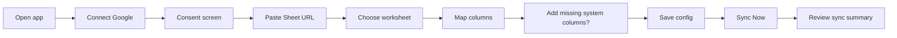
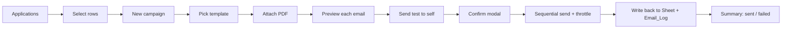

# Product Requirements Document — Job Application Email Automation System

Status: Draft for review · Version 0.2 · Nov 2026 (adds the mobile-first redesign, global UI, and the installable PWA; see UI_UX_PLAN.md and PWA_STRATEGY.md)

---

## 1. Objective

Build a personal, frontend-only dashboard that turns a Google Sheet of job leads into a controlled, trackable recruiter-outreach workflow:

1. Connect a Google account (OAuth via Google Identity Services).
2. Connect a Google Sheet that holds job applications.
3. Sync records into the dashboard (read + validate, never send).
4. Write personalized emails from reusable templates.
5. Send reviewed emails, with a resume PDF attached, through the user's own Gmail.
6. Write the results (status, date, Gmail IDs) back to the Sheet.
7. Detect replies where the Gmail API makes that reliably possible.
8. Report on activity and export CSVs.

There is no backend. Google Sheets is the system of record, Gmail is the sending provider, and the browser (LocalStorage) holds only configuration and preferences.

## 2. Target user

A single job seeker (the owner of the Google account) who:

- Keeps job leads in a Google Sheet.
- Sends 5–50 personalized recruiter emails per day, not bulk marketing.
- Wants status tracking without paying for a CRM or running a server.

Multi-user, team, and agency use are out of scope.

## 3. Problems being solved

| Problem | How the product addresses it |
|---|---|
| Copy-pasting the same email and editing names by hand | Templates with placeholders and per-recipient preview |
| Forgetting who was already emailed | Email status written to the Sheet, plus duplicate-send guards |
| Sheet and inbox drift out of sync | Gmail message and thread IDs stored per row; reply checks by thread |
| No visibility into effort and results | Dashboard metrics, weekly and monthly charts, CSV export |
| Mass-mail tools feel spammy and risky | Explicit review, test send, final confirmation, daily cap, throttling |

## 4. Scope

### 4.1 MVP features

1. **Google connection**: sign in, show the connected Gmail address, detect token expiry, reconnect, disconnect (revoke).
2. **Sheets connection**: paste URL, extract the spreadsheet ID, pick a worksheet, read headers, map columns, save config, show status.
3. **Sync Now**: read rows, validate emails, detect duplicates, show imported/skipped/invalid counts, assign stable Application IDs. Never sends.
4. **Templates**: three defaults, plus create, edit, duplicate, delete; subject and body; placeholders; live preview.
5. **Campaigns**: select one or many applications, choose a template, preview each email, attach a PDF resume, send a test email to self, confirm, send through the Gmail API with throttling, track per-recipient success or failure.
6. **Sheet write-back**: Email Status, Sent Date, Gmail Message ID, Thread ID, Application Status, Last Error.
7. **Duplicate-send protection**: block re-sending to rows already marked Sent unless explicitly overridden.
8. **Email history**: a log of every send attempt, stored in an `Email_Log` worksheet in the same spreadsheet.
9. **Reply tracking (thread-based)**: on demand, check each sent thread for messages from someone other than the user. Classify as Replied, Auto-reply, Bounced, No reply, or Uncertain.
10. **Reports**: totals, status breakdown, weekly and monthly activity, CSV export.
11. **Settings**: sender profile (name, phone, LinkedIn, portfolio), sending limits, delay between sends, theme, data reset.
12. **Mobile-first, responsive UI**: every page is fully usable from 320 px to 1440 px and above, including sending a campaign and editing templates on a phone.
13. **Global UI**: command palette with global search, notification center, profile menu, theme switcher, sync status, connection indicators, toasts, confirmation dialogs, skeleton loading, and first-run onboarding.
14. **Installable PWA**: an Install App option on desktop and mobile, offline app shell, offline indicator, user-approved retry after reconnect, and an update prompt.

### 4.2 Future features (not in MVP)

- Follow-up sequences, such as a reminder after N days with no reply (manual trigger only, since there is no backend scheduler).
- HTML email templates with a rich-text editor.
- Google Picker plus the `drive.file` scope, to avoid the broad `spreadsheets` scope.
- Storing templates in a `Templates` worksheet, so they sync across browsers.
- Resume storage in Google Drive, so it syncs across devices (the MVP keeps it in this browser's IndexedDB).
- Search-based reply detection with `gmail.readonly`, for replies that arrive outside the original thread.
- Multiple resumes per job category.
- **Native Android APK**, either by wrapping the PWA as a Trusted Web Activity (Bubblewrap or PWABuilder) or by using Capacitor. This is a separate project with its own signing, Play Store listing, and OAuth client type. The MVP ships a PWA, which is installable but is not an APK (PWA_STRATEGY.md §1).
- Background Sync or push notifications. These need a server or a service worker that holds tokens, which the security rules forbid.

### 4.3 Explicitly out of scope

- Any server, database, Firebase, or serverless function.
- Scheduled or background sending while the browser tab is closed.
- Open or click tracking (tracking pixels). This is unreliable and inappropriate for recruiter outreach.
- Scraping job boards.
- Sending from non-Gmail providers.

## 5. Functional requirements

### FR-1 Authentication
- FR-1.1 The user can click "Connect Google" to start the Google Identity Services (GIS) token flow.
- FR-1.2 The app requests only the scopes needed for enabled features. Reply tracking scopes are requested only when the user turns on reply tracking.
- FR-1.3 The app shows the connected email address (from the OpenID userinfo endpoint).
- FR-1.4 The app tracks the token expiry time. When fewer than 5 minutes remain, the UI shows "Session expiring — Reconnect".
- FR-1.5 A 401 from any Google API marks the session as expired and pauses any running campaign.
- FR-1.6 Disconnect revokes the token and clears in-memory auth state.

### FR-2 Sheets connection
- FR-2.1 Accept a full Sheets URL or a raw spreadsheet ID, and extract the ID with `/\/spreadsheets\/d\/([a-zA-Z0-9-_]+)/`.
- FR-2.2 List worksheets (tabs) using `spreadsheets.get` with a `fields` mask.
- FR-2.3 Read row 1 of the selected tab as headers.
- FR-2.4 Auto-map headers to app fields by normalized name, and allow manual override.
- FR-2.5 Required mappings: Company Name, Recruiter Email, Job Title. Others are optional.
- FR-2.6 If system columns are missing (Application ID, Email Status, Sent Date, Gmail Message ID, Thread ID, Reply Status, Last Error), offer to append them to the header row. This requires user confirmation.
- FR-2.7 Save the config (spreadsheet ID, tab name, column mapping) to LocalStorage.

### FR-3 Sync Now
- FR-3.1 Read all data rows of the mapped tab.
- FR-3.2 Validate the recruiter email (syntax, trimmed, lower-cased for comparison).
- FR-3.3 Rows with no recruiter email or an invalid one are counted as **Invalid** and shown with the reason.
- FR-3.4 Duplicate rows (same dedupe key, see DATABASE_SCHEMA.md) are counted as **Skipped**. Only the first occurrence is imported.
- FR-3.5 Rows without an Application ID get a generated UUID written back in one batch update.
- FR-3.6 Show a sync summary: total rows, imported, skipped (duplicates), invalid, and IDs assigned.
- FR-3.7 Sync must never trigger email sending.

### FR-4 Templates
- FR-4.1 Ship three defaults: Cold Outreach, Application Follow-up, Referral / Networking Request.
- FR-4.2 Support create, edit, duplicate, and delete. Deleting the last template is blocked.
- FR-4.3 Supported placeholders: `{{recruiter_name}}`, `{{recruiter_first_name}}`, `{{company_name}}`, `{{job_title}}`, `{{job_link}}`, `{{my_name}}`, `{{my_phone}}`, `{{my_linkedin}}`, `{{my_portfolio}}`.
- FR-4.4 Fallback syntax: `{{recruiter_first_name|there}}` uses "there" when the value is empty.
- FR-4.5 Unknown placeholders and empty placeholders without a fallback are highlighted as warnings in preview and block sending for the affected recipient.
- FR-4.6 Preview renders against a selected application or sample data.
- FR-4.7 Templates persist in LocalStorage, with JSON export and import for backup.

### FR-5 Campaigns
- FR-5.1 Select recipients from the Applications table (single, multi, or filtered).
- FR-5.2 By default, exclude rows with Email Status = Sent, Sending, or Do Not Email, and show why each was excluded.
- FR-5.3 Choose a template, and optionally edit the subject or body for this campaign only.
- FR-5.4 Attach one PDF resume. Validate MIME type `application/pdf` and a size of 5 MB or less (recommended limit).
- FR-5.5 Per-recipient preview, with the option to step through all recipients.
- FR-5.6 "Send test email" sends recipient #1's rendered email to the connected address with a `[TEST]` subject prefix. This does not change the Sheet.
- FR-5.7 A final confirmation modal shows the recipient count, template, attachment name, and estimated duration. The user must type or click an explicit confirm.
- FR-5.8 Sending is sequential, with a configurable delay (default 20 s) and a daily cap (default 50).
- FR-5.9 Each send updates the UI live: Queued, Sending, Sent or Failed.
- FR-5.10 The user can pause or cancel. A pending queue survives a page reload (stored in LocalStorage) and requires explicit resume.
- FR-5.11 On a 401, pause and prompt to reconnect. On a 429 or 5xx, retry with exponential backoff (up to 3 attempts), then mark Failed.

### FR-6 Sheet write-back
- FR-6.1 After each successful send, write Email Status = Sent, Sent Date (ISO 8601), Gmail Message ID, Thread ID, Template Name, and Application Status = Applied (only if it was empty or "Not Applied").
- FR-6.2 After a failed send, write Email Status = Failed and Last Error.
- FR-6.3 Rows are located by Application ID, re-read immediately before writing, never by a cached row number.
- FR-6.4 Append one row per attempt to the `Email_Log` worksheet. It is created on first use.
- FR-6.5 If the write-back fails after a successful send, the app keeps the result in a LocalStorage "pending write-backs" list and retries on the next sync. The email is never re-sent.

### FR-7 Reply tracking
- FR-7.1 The user turns on reply tracking, which triggers incremental consent for `gmail.metadata`.
- FR-7.2 "Check Replies" calls `threads.get` (format=metadata) for each sent Thread ID.
- FR-7.3 Classification rules are defined in API_INTEGRATION.md §6. Anything ambiguous is marked **Uncertain**, never Replied.
- FR-7.4 Write Reply Status and Reply Date back to the Sheet.
- FR-7.5 The UI states clearly that only replies in the same Gmail thread are detected.

### FR-8 Reports
- FR-8.1 KPI cards: Total Applications, Emails Sent, Failed, Replies, Reply Rate.
- FR-8.2 Application status breakdown (donut or bar chart).
- FR-8.3 Weekly activity (last 12 weeks) and monthly activity (last 12 months) for sends and replies.
- FR-8.4 CSV export of applications (current filter) and of the email log.

### FR-9 Settings
- FR-9.1 Sender profile used by the `my_*` placeholders.
- FR-9.2 Sending limits: delay between sends, daily cap, and an override for already-sent rows (off by default).
- FR-9.3 Theme: light, dark, or system.
- FR-9.4 Reset local data, clearing LocalStorage (Sheet data is not affected).
- FR-9.5 Install App section: shows the install button, platform instructions, or "Installed" depending on the browser.
- FR-9.6 Offline snapshot toggle: whether the last-synced applications and log are kept on this device for offline viewing.

### FR-10 Progressive Web App
- FR-10.1 A web app manifest with name "JobApply Automation", short name "JobApply", theme and background colors, `standalone` display, icons (192, 512, maskable 512, Apple touch 180), and start URL `/`.
- FR-10.2 Capture `beforeinstallprompt` and show an Install App option in Settings, the profile menu, the mobile drawer, and the command palette. Hide the option when installed or unsupported.
- FR-10.3 On iOS and iPadOS, show "Share → Add to Home Screen" instructions. Never promise an automatic prompt.
- FR-10.4 Detect installed mode (`display-mode: standalone`, `navigator.standalone`, `appinstalled`) and show "Installed".
- FR-10.5 Precache the app shell and static assets. An in-app Offline screen replaces any page that needs the network.
- FR-10.6 Show an offline banner, disable Google actions with a reason, and show "Back online" with pending work when the connection returns.
- FR-10.7 After reconnecting, nothing runs automatically. Pending syncs, write-backs, and campaigns each need a user action, and resuming a campaign repeats the send confirmation.
- FR-10.8 When a new version is deployed, show "Update ready" with Reload and Later. Reload is disabled while a campaign is sending.
- FR-10.9 The service worker never caches Google API requests or responses, never sees tokens, and only serves same-origin build assets.

### FR-11 Global UI
- FR-11.1 Command palette (Ctrl/⌘+K, and a search button on mobile): navigate, run actions, and search applications and templates in memory.
- FR-11.2 Notification center: a local list of events from this device (campaign finished, replies found, sync results, updates), capped at 50, with mark-as-read and clear.
- FR-11.3 Profile menu: account, connection state, theme, install, shortcuts, disconnect.
- FR-11.4 Sync status and Google connection status are always visible in the shell.
- FR-11.5 Destructive or irreversible actions (send, disconnect, reset, delete template) use a confirmation dialog. On mobile this is a bottom sheet.
- FR-11.6 First-run onboarding: connect Google, connect sheet, map columns, first sync, profile. Steps can be resumed later.

## 6. Non-functional requirements

| ID | Category | Requirement |
|---|---|---|
| NFR-1 | Architecture | Static SPA. Deployable to any static host. No server code. |
| NFR-2 | Security | Access token held in memory only. Never written to LocalStorage. No client secret anywhere in the bundle. |
| NFR-3 | Security | All user and sheet content rendered as text. No `dangerouslySetInnerHTML` for email previews. |
| NFR-4 | Honesty | The UI never shows success unless the Google API returned success. Mock data exists only in the UI phases (Phases 2–3), is labeled "Mock data" on screen, and sits behind an explicit `VITE_USE_MOCKS` flag. |
| NFR-5 | Performance | Sync of 1,000 rows completes in under 3 s on broadband (one `values.get` call). |
| NFR-6 | Performance | Initial JS (shell and Dashboard) at most 180 KB gzipped, other route chunks at most 60 KB, routes lazy-loaded, Recharts in its own chunk. Lighthouse mobile: Performance ≥ 90, Accessibility 100, Best Practices 100. |
| NFR-7 | Reliability | Every API call has loading, success, and error states, plus a human-readable error message. |
| NFR-8 | Compliance | Sending is throttled and capped. Each email is sent one-to-one (single `To`). No BCC blasts. |
| NFR-9 | Accessibility | WCAG 2.2 AA: keyboard navigable, visible focus rings, AA contrast in both themes, `aria-live` for send progress, text alternatives for charts, reduced-motion support, 44 × 44 px touch targets. |
| NFR-10 | Responsiveness | Mobile-first. Every flow, including sending and template editing, is fully usable at 320 px and above, with no horizontal page scroll. Layouts adapt (lists, sheets, steppers) rather than shrink. |
| NFR-11 | Maintainability | Google API calls live only in `src/services/`. Components never call `fetch` directly. |
| NFR-12 | Security (PWA) | Every Google request uses `cache: 'no-store'`. The service worker has no runtime caching. No credentials in LocalStorage, IndexedDB, or Cache Storage. |
| NFR-13 | Design consistency | All styling comes from the design tokens (UI_UX_PLAN.md §2). No raw color values in components. No em-dashes in UI copy (checked by `lint:copy`). |

## 7. User workflows

### 7.1 First-time setup

### 7.2 Send a campaign

### 7.3 Check replies
Email History → "Check replies" → (first time: grant metadata scope) → threads checked → statuses updated → Sheet updated.

## 8. Acceptance criteria

| # | Criterion |
|---|---|
| AC-1 | Given a valid Google account, when I click Connect, then my Gmail address is displayed and the status badge shows "Connected". |
| AC-2 | Given an expired token, when any API call returns 401, then a "Reconnect" banner appears and no data is lost. |
| AC-3 | Given a Sheets URL, the app extracts the correct ID, lists all tabs, and shows the header row. |
| AC-4 | Given a sheet with 100 rows (5 invalid emails, 3 duplicates), Sync shows Imported 92, Invalid 5, Skipped 3. |
| AC-5 | Sync Now never calls any Gmail endpoint. This is verified by test. |
| AC-6 | Templates survive a page reload. Defaults are restored only when no templates exist. |
| AC-7 | A preview with a missing required placeholder value shows a warning, and that recipient cannot be sent. |
| AC-8 | The test email arrives in my own inbox with the PDF attached and the `[TEST]` prefix, and no Sheet row changes. |
| AC-9 | Campaign send cannot start without passing the confirmation modal. |
| AC-10 | After a successful send, the Sheet row shows Email Status = Sent, the Sent Date, the Gmail Message ID, and the Thread ID. |
| AC-11 | A row with Email Status = Sent is excluded from new campaigns unless the override setting is on and confirmed per campaign. |
| AC-12 | Reloading mid-campaign shows a "Resume campaign?" prompt. Already-sent recipients are not re-sent. |
| AC-13 | A reply in the same thread from the recruiter shows as Replied. An out-of-office reply shows as Auto-reply. A bounce shows as Bounced. |
| AC-14 | The Reports CSV export opens correctly in Excel and Google Sheets (UTF-8 BOM, quoted fields). |
| AC-15 | No access token is present in LocalStorage after any flow (checked in DevTools). |
| AC-16 | At 320, 375, 390, 430, 768, 1024, 1280, and 1440 px, every page has no horizontal page scroll, and every interactive target is at least 44 × 44 px on touch devices. |
| AC-17 | Every chart has a "View as table" option and a one-sentence text summary. |
| AC-18 | After one sync, the app opens offline, shows the snapshot labeled "Offline · last synced …", and disables every Google action with a reason. |
| AC-19 | When the connection returns, no request to Gmail or Sheets is made until the user clicks Retry or Resume. Resuming a campaign shows the send confirmation again. |
| AC-20 | On Chrome or Edge (desktop and Android), DevTools reports no installability errors and Install App opens the browser prompt. On iOS, the instructions are shown. When installed or unsupported, the install button is hidden. |
| AC-21 | After a full flow (connect, sync, send, check replies), Cache Storage contains only same-origin build assets, and no token exists in any browser storage. |
| AC-22 | Google sign-in works inside the installed app on Windows Chrome and Android Chrome. The iOS home-screen result is documented. |
| AC-23 | After a new deploy, the app shows "Update ready". Reload applies it. Reload is disabled while a campaign is sending. |

## 9. Decisions (confirmed by reviewer)

1. **Sheet access scope**: the full `spreadsheets` scope, so any pasted URL works.
2. **Resume persistence**: the PDF is stored in the browser's **IndexedDB**, so it persists across sessions on the same browser. It's one record holding the Blob, filename, size, and upload date. Replace and Remove are available in Settings and in the Campaign attachment step. The file is still validated as PDF and ≤ 5 MB.
3. **Reply tracking**: in the MVP, thread-based, using the `gmail.metadata` scope (incremental consent).
4. **Email format**: plain text.
5. **Hosting**: Vercel.
6. **Sending defaults**: 50/day cap, 20 s between sends.

v0.2 design decisions D1–D6 are confirmed (DEVELOPMENT_ROADMAP.md §6): Geist, cobalt accent, bottom tabs plus drawer, `any` orientation, offline snapshot on by default.
