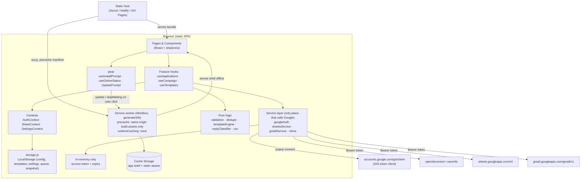
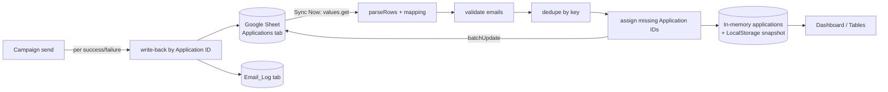

# Technical Architecture

Status: Draft for review · Version 0.2 (adds the service worker / PWA layer, offline and reconnect states, and the v2 folder structure)

---

## 1. Summary

A static React SPA (Vite) talks directly from the browser to three Google endpoints, each with its own OAuth 2.0 access token:

- **Google Identity Services (GIS)**, for the OAuth token.
- **Google Sheets API v4**, which holds the application records and email log.
- **Gmail API v1**, for sending and for reading thread metadata to detect replies.

There is no server. The browser holds UI state in memory and saves configuration in LocalStorage. All durable business data lives in the user's Google Sheet.

The app is also an installable **PWA**. A Workbox-generated service worker precaches only the app's own build assets (the HTML shell, JS, CSS, fonts, and icons), so the shell opens offline. It never intercepts or caches Google traffic. See PWA_STRATEGY.md for the full design.

## 2. Architecture diagram



The service worker sits on the page's own origin and only answers navigations and requests for precached files. Requests to `googleapis.com` and `accounts.google.com` are cross-origin, are not in the precache, and have no runtime route, so they go straight to the network. Each service request also sets `cache: 'no-store'`, so the HTTP cache doesn't keep Google responses either.

Layering rules:
- **Components** render and dispatch. They never import from `services/`.
- **Hooks** orchestrate: they call services and pure lib functions, and expose `{data, status, error, actions}`.
- **Services** are the only modules that know URLs, scopes, and HTTP. They return plain JS objects and throw typed `GoogleApiError`s.
- **lib/** is pure, synchronous, and framework-free. It is fully unit-testable.

## 3. Google OAuth flow (GIS token model)

A frontend-only app cannot keep a client secret, so it uses the **GIS token model** (`google.accounts.oauth2.initTokenClient`). This returns a short-lived access token (about 1 hour) and **no refresh token**. The authorization-code model requires a server to exchange the code with the client secret, so it is not used.

```mermaid
sequenceDiagram
  participant U as User
  participant App as SPA
  participant GIS as Google Identity Services
  participant API as Google APIs

  App->>GIS: load https://accounts.google.com/gsi/client
  App->>GIS: initTokenClient({client_id, scope, callback})
  U->>App: click "Connect Google"
  App->>GIS: tokenClient.requestAccessToken({prompt: 'consent'})
  GIS->>U: popup: account chooser + consent
  U->>GIS: approve
  GIS-->>App: callback({access_token, expires_in, scope})
  App->>App: store token + expiresAt in memory; check granted scopes
  App->>API: GET userinfo (Bearer)
  API-->>App: { email, name, picture }
  Note over App: ~55 min later or on 401
  App->>U: banner "Session expiring — Reconnect"
  U->>App: click Reconnect (user gesture → avoids popup blocker)
  App->>GIS: requestAccessToken({prompt: ''})
  GIS-->>App: new access_token (usually no consent screen)
```

Key points:
- The token request must happen inside a **user click handler**, or browsers may block the popup.
- After a callback, check the granted scopes with `google.accounts.oauth2.hasGrantedAllScopes(token, ...)`. The user can untick individual scopes on the consent screen, so the UI must degrade gracefully (for example, Sheets works but Gmail send is disabled).
- **Incremental authorization**: the base scopes are requested at connect time. `gmail.metadata` is requested later, when the user turns on reply tracking (`include_granted_scopes: true`).
- **Disconnect** calls `google.accounts.oauth2.revoke(accessToken)` and clears memory.
- **On reload** the token is gone, because it lives in memory only. The app remembers that the user connected (`hasConnectedBefore`, plus `login_hint` = email) and shows a one-click "Reconnect" button that passes `login_hint` for a fast, usually consent-free popup.

## 4. Token management

| Concern | Decision |
|---|---|
| Where the token lives | A module-scoped variable in `services/googleAuth.js`, plus a React `AuthContext` for status only. |
| Persistence | None. sessionStorage persistence is an optional setting, off by default, documented as an XSS risk. |
| Expiry tracking | `expiresAt = Date.now() + expires_in*1000`. A timer flips status to `expiring` at T−5 min and to `expired` at T. |
| Pre-flight check | Before a campaign starts, require at least 10 minutes of remaining validity, or ask the user to reconnect first. |
| Mid-campaign expiry | A 401 pauses the queue and saves its state. The user reconnects and resumes. No send is retried without a fresh token. |
| Revocation | Disconnect calls `revoke` and clears config only if the user chooses "Disconnect and forget". |

## 5. Google Sheets integration

`services/sheetsService.js` uses `fetch` against REST endpoints. It does not use the `gapi` client library, which keeps dependencies lighter.

| Operation | Endpoint |
|---|---|
| List tabs | `GET /v4/spreadsheets/{id}?fields=properties.title,sheets.properties(sheetId,title,gridProperties)` |
| Read headers | `GET /v4/spreadsheets/{id}/values/{tab}!1:1` |
| Read all rows | `GET /v4/spreadsheets/{id}/values/{tab}?valueRenderOption=UNFORMATTED_VALUE&dateTimeRenderOption=FORMATTED_STRING` |
| Write specific cells | `POST /v4/spreadsheets/{id}/values:batchUpdate` (`valueInputOption=RAW`) |
| Append log row | `POST /v4/spreadsheets/{id}/values/Email_Log!A1:append?valueInputOption=RAW&insertDataOption=INSERT_ROWS` |
| Create Email_Log tab | `POST /v4/spreadsheets/{id}:batchUpdate` with `addSheet` request |

Write-back strategy (to avoid row-shift bugs):
1. Read the Application ID column (one `values.get` call for that column only).
2. Find the current row index for each target Application ID.
3. Build A1 ranges for only the app-owned columns, and send one `values:batchUpdate`.
4. If an ID is not found (the row was deleted), log a warning and skip the write. Never write blindly.

## 6. Gmail integration

`services/gmailService.js` plus `lib/mime.js`.

- **Send**: `POST https://gmail.googleapis.com/upload/gmail/v1/users/me/messages/send?uploadType=media` with `Content-Type: message/rfc822` and the raw MIME message as the body. The response includes `{id, threadId, labelIds}`.
  - The media-upload endpoint is used instead of the JSON `{raw}` form because it handles attachment-sized payloads (up to 35 MB) cleanly. Google's documented limit for the `/upload` messages endpoint is 35 MB, and Gmail's normal attachment limit is 25 MB.
- **MIME building** (`lib/mime.js`, no dependency):
  - `multipart/mixed` with a `text/plain; charset=UTF-8` part (quoted-printable or base64) and an `application/pdf` part (base64, 76-char lines, `Content-Disposition: attachment; filename="..."`).
  - Headers: `From: "My Name" <me@gmail.com>`, `To`, `Subject` (RFC 2047 `=?UTF-8?B?...?=` when non-ASCII), `MIME-Version: 1.0`.
- **Reply check**: `GET /gmail/v1/users/me/threads/{threadId}?format=metadata&metadataHeaders=From&metadataHeaders=Subject&metadataHeaders=Auto-Submitted&metadataHeaders=Date`. See API_INTEGRATION.md §6.
- **Identity**: the user's address comes from `https://openidconnect.googleapis.com/v1/userinfo`. `users.getProfile` is not used, because it is not authorized by the `gmail.send` scope alone.

## 7. Data synchronization model



- **The source of truth is the Sheet.** The app's copy is a cache, refreshed only on Sync Now (and automatically before a campaign starts).
- **Snapshot cache**: the last synced rows are saved in LocalStorage (`jaas.snapshot`) so the dashboard renders instantly on reload, and so the app has data offline. The snapshot is labeled "Last synced X min ago". If it exceeds about 2 MB, the app stores only the summary and re-syncs. It can be turned off in Settings (decision D5). It is cleared on disconnect-and-forget and on reset.

### 7.1 Offline and reconnect model

| Network state | Behavior |
|---|---|
| Online | Normal. |
| Offline (`navigator.onLine === false`, or a fetch fails with `TypeError`) | Offline banner. Read-only views use the snapshot. Every Google action is disabled with "Needs a connection". A running campaign pauses **before** the next send. The recipient in flight is resolved as in DATABASE_SCHEMA §3.2. |
| Back online (`online` event) | "Back online" toast listing pending work: unsynced changes, pending write-backs, and a paused campaign. **Nothing runs automatically.** Retry runs write-backs and sync. Resume campaign re-opens the send confirmation. |

The `online` event is only a hint. The first real request still verifies connectivity, and failures fall back to the offline state.
- **Column ownership**: the app writes **only** to system columns (Application ID, Email Status, Sent Date, Gmail Message ID, Thread ID, Template Name, Reply Status, Reply Date, Last Error) and to Application Status when it advances "Not Applied" to "Applied". User-owned columns are never overwritten.
- **Conflict policy**: the most recent write wins for system columns. Before sending, each row's Email Status is re-read from the Sheet, so a row another device already marked Sent is skipped.

## 8. State management

React built-ins only: Context, `useReducer`, and custom hooks. No Redux, Zustand, or React Query. The data volume (under a few thousand rows) and the single-user model don't justify them.

| State | Holder | Persisted |
|---|---|---|
| Auth status, user email, granted scopes | `AuthContext` | `login_hint` email only |
| Access token | `googleAuth.js` module variable | Never |
| Sheet config (ID, tab, mapping) | `SheetContext` | LocalStorage |
| Applications (synced rows) | `SheetContext` | LocalStorage snapshot |
| Templates | `useTemplates` hook | LocalStorage |
| Settings / sender profile | `SettingsContext` | LocalStorage |
| Campaign draft and queue | `useCampaign` hook | LocalStorage (queue only, for resume) |
| Pending write-backs | `useCampaign` | LocalStorage |
| Toasts, modals | Component-local and `sonner` | No |
| Notifications (center) | `NotificationContext` | LocalStorage, last 50 |
| Network status | `useOnlineStatus` | No |
| Install state, deferred prompt | `useInstallPrompt` (module-level capture in `main.jsx`) | No (installed state is re-detected) |
| Update available | `useRegisterSW` in `UpdatePrompt` | No |

## 9. LocalStorage usage

All keys share the `jaas.` prefix, and each stored object has a `version` field for future migrations. Access goes through `lib/storage.js` (JSON parse with try/catch and a quota-exceeded handler).

| Key | Contents | Approx. size |
|---|---|---|
| `jaas.settings` | theme, sender profile, delay, daily cap | < 2 KB |
| `jaas.sheetConfig` | spreadsheetId, tabName, sheetId, columnMap | < 2 KB |
| `jaas.templates` | array of templates | < 50 KB |
| `jaas.snapshot` | last synced rows and syncedAt | ≤ 2 MB |
| `jaas.campaignQueue` | in-progress queue (IDs plus status) | < 50 KB |
| `jaas.pendingWritebacks` | sends whose Sheet update failed | < 20 KB |
| `jaas.dailySendCount` | `{date, count}` for the daily cap | < 1 KB |
| `jaas.auth.hint` | last connected email (for `login_hint`) | < 1 KB |
| `jaas.theme` | `light`, `dark`, or `system` (owned by `next-themes`, plain string) | < 1 KB |
| `jaas.logSnapshot` | last 500 Email_Log rows for offline History (same toggle as the snapshot) | ≤ 300 KB |
| `jaas.notifications` | notification center items, last 50 | < 20 KB |
| `jaas.ui` | sidebar collapsed, table density, column visibility, onboarding progress, install-dialog dismissed date | < 2 KB |

Never stored: access tokens, ID tokens, or email bodies of sent messages (the Email_Log tab stores the subject only). Cache Storage holds build assets only.

### 9.1 IndexedDB (resume only)

LocalStorage holds only strings and is capped at about 5 MB, so the resume PDF is kept in IndexedDB instead. This is browser-local storage, not a separate database service.

- Database `jaas`, object store `files`, with a single key `resume`, stored as `{ blob, name, size, type, savedAt }`.
- Access goes through `lib/fileStore.js`, a small wrapper around the native `indexedDB` API with no dependency (about 40 lines).
- It's read once when a campaign starts and converted to base64 for MIME.
- Settings → Data → "Reset local data" also clears it.
- If IndexedDB is unavailable (for example in some private browsing modes), the app falls back to holding the file in memory for the session and shows a notice.

## 10. Error handling

A single `GoogleApiError` class (`status`, `code`, `reason`, `userMessage`, `retryable`) is created in `services/http.js`, which is the one `fetch` wrapper used by every service.

| HTTP / condition | Meaning | Handling |
|---|---|---|
| Network failure / offline | No connectivity | Offline banner. Pause the queue before the next send. On reconnect, show pending work and wait for the user to click Retry or Resume (§7.1). |
| 400 | Bad request (bad range, malformed MIME) | Not retryable. Show the API message. Mark the row Failed with the reason. |
| 401 | Token expired or revoked | Set auth status to expired, pause the queue, show the Reconnect banner. |
| 403 `insufficientPermissions` / `ACCESS_TOKEN_SCOPE_INSUFFICIENT` | Missing scope | Prompt incremental consent for that feature. |
| 403 `PERMISSION_DENIED` (Sheets) | No access to that spreadsheet | "Your account can't edit this sheet. Check sharing." |
| 403 `rateLimitExceeded` / `userRateLimitExceeded`, 429 | Quota | Exponential backoff (2 s, 4 s, 8 s, with jitter), max 3 attempts, then Failed. |
| 403 / 400 with Gmail daily-limit wording | Gmail sending limit reached | Stop the campaign and mark the remainder "Not sent — limit". Do not retry until tomorrow. |
| 404 | Spreadsheet or thread not found | Config error UI, or Reply Status = Uncertain. |
| 5xx | Google side | Backoff retry as for 429. |

UI rules: every async action exposes `idle | loading | success | error`. Errors show a human message plus an expandable "Technical details". Success is shown only after a 2xx response.

## 11. Security model (frontend-only)

- **OAuth Client ID is public by design.** It is protected by **Authorized JavaScript origins** in Google Cloud (production domain plus `http://localhost:5173`).
- **No client secret, no API key needed.** All calls are OAuth-authorized.
- **XSS is the main threat.** If script runs in the page, it can use the in-memory token. Mitigations:
  - React text rendering only. Email preview is rendered as plain text inside `<pre>`/whitespace-preserving elements.
  - Strict Content-Security-Policy via the host's headers config: `default-src 'self'; script-src 'self' https://accounts.google.com/gsi/client; connect-src 'self' https://*.googleapis.com https://accounts.google.com; frame-src https://accounts.google.com; worker-src 'self'; manifest-src 'self'; img-src 'self' data: https://lh3.googleusercontent.com; style-src 'self' 'unsafe-inline'; font-src 'self'`. The `img-src` Google host is only needed if the profile avatar is shown, and `'unsafe-inline'` styles are needed by Radix positioning and the GIS button.
  - Minimal third-party dependencies, with a lockfile committed.
- **Service worker rules** (verbatim requirements, mapped in PWA_STRATEGY §7):
  - Never cache Gmail OAuth tokens in the service worker.
  - Never cache private Gmail API responses.
  - Never cache sensitive Google Sheets responses in shared caches.
  - Never store credentials in LocalStorage.
  - Do not send emails automatically after reconnection.
  - Require user approval before resuming any pending operation.

  These rules are implemented with an empty `runtimeCaching`, a precache glob limited to build output, `cache: 'no-store'` on every request in `services/http.js`, a memory-only token, and the reconnect model in §7.1.
- **Sheet data is untrusted input.** Formula-like values (starting with `=`, `+`, `-`, `@`) are escaped in CSV exports to prevent CSV injection. Writes use `valueInputOption=RAW`, so the app never creates formulas.

## 12. Deployment

- `vite build` produces static files in `dist/`.
- Host: Vercel or Netlify (recommended), or GitHub Pages.
- SPA fallback: `vercel.json` / `_redirects` rewrite all paths to `/index.html` (static host config, not a server). Alternatively, use `HashRouter` on GitHub Pages.
- Environment: `VITE_GOOGLE_CLIENT_ID` (public), `VITE_USE_MOCKS` (dev only).
- Add every deployed origin to the OAuth client's Authorized JavaScript origins.
- Headers: `Cache-Control: no-cache` for `/sw.js`, `/registerSW.js`, and `/manifest.webmanifest`. Hashed assets under `/assets/` get `public, max-age=31536000, immutable`.
- The service worker requires HTTPS. `localhost` is exempt, and the SW is disabled in `vite dev` (`devOptions.enabled: false`), so test the PWA with `vite build && vite preview` or a Vercel preview.

## 13. Folder structure

See DEVELOPMENT_ROADMAP.md §1. The main v2 additions are:
- `src/app/`: routes, providers, and the single navigation config.
- `src/components/layout/` and `src/components/global/`: the responsive shell and global UI.
- `src/pwa/`: install, network, update, and wake lock.
- `scripts/lint-copy.js`.
